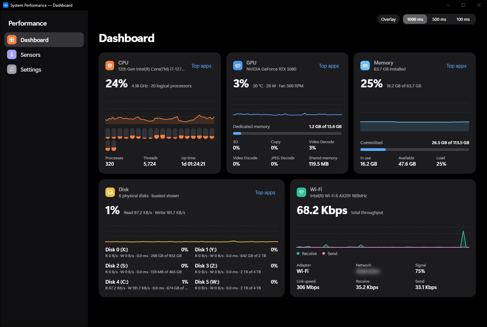
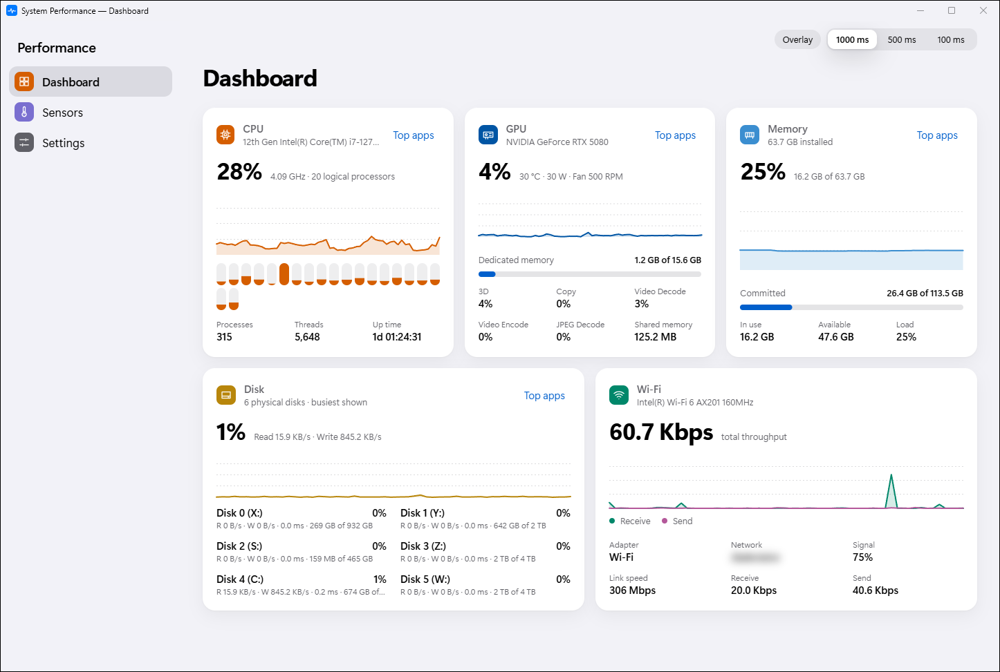
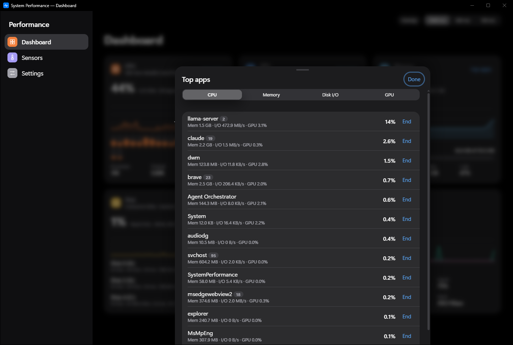
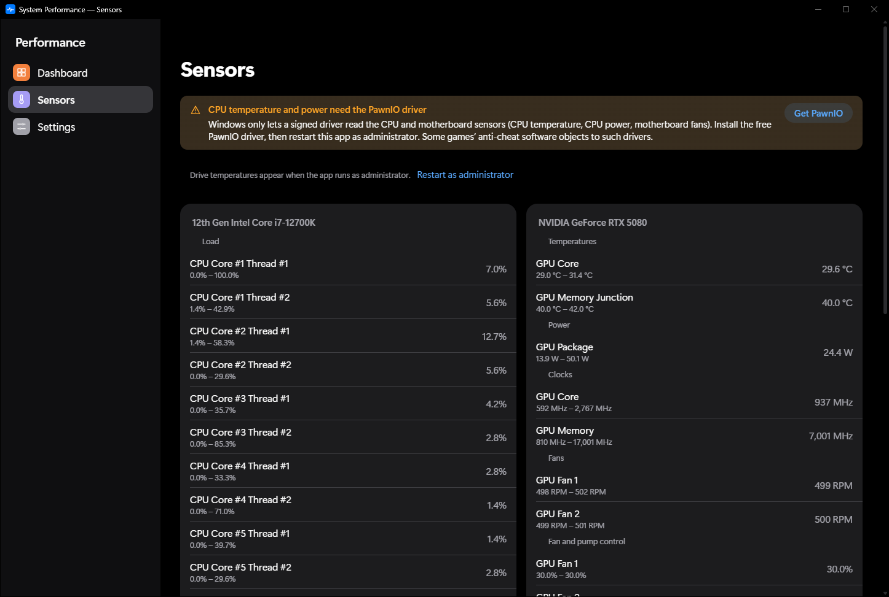

# System Performance

**Your whole PC on one screen: CPU, GPU, memory, every disk and your network, live, up to ten times a second.**

[**⬇ Download the latest release**](https://github.com/An0sTheGreat/system-performance/releases/latest) · one `.exe`, nothing to install · free and open source

Task Manager makes you click through tabs and refreshes twice a second at its fastest. Hardware monitors show hundreds of rows in a tree and leave you to work out what matters. System Performance puts the five things you check, CPU, GPU, memory, disks and network, side by side on one screen, each with its own 60-second chart. It updates every second, every half second or ten times a second, and it looks like a Windows 11 app rather than a 2005 utility.

## Why use it

- **Everything at once.** Five live cards on one screen, with no tabs and no scrolling. Per-core CPU bars, GPU engines and VRAM, committed memory, every physical drive, and Wi-Fi signal and throughput.
- **Fast when you need it.** Switch between 1000, 500 and 100 ms updates from the top bar. The charts always cover the last minute.
- **A tab for every part.** Click any card to open its own tab: CPU (per-thread load and clocks, P/E cores, caches, AI instruction sets), GPU (every engine, VRAM per app, temperature and power history), Memory (composition, modules, XMP/EXPO check), Disks (pick any drive) and Network (router latency, jitter and Wi-Fi details).
- **Find the culprit in one click.** *Top apps* on any card lists the programs using the most CPU, memory, disk or GPU, grouped by program, with a two-click **End**.
- **Temperatures and watts.** GPU temperature, power, clocks and fan speed work out of the box, with CPU temperature and power when the PawnIO driver is installed. Battery drain and time left on laptops.
- **An overlay for games.** A slim always-on-top strip of CPU, GPU, RAM, temperatures and network that clicks pass through. It's drawn by the app itself and never touches the game.
- **Light on your PC.** Under 3% of one CPU core with the window open at the default rate on the test machine. It drops to once a second for the tray icon when hidden, and pauses completely when nothing needs it.
- **Private and portable.** A single `.exe` with .NET bundled. No account, no telemetry, and nothing leaves your PC (the internet ping on the Network tab is opt-in).
- **At home in Windows 11.** Light and dark themes that follow Windows, a title bar that matches the app, and it closes to the tray with a live CPU % icon.

| Light mode | Top apps |
|---|---|
|  |  |

| Sensors | Game overlay |
|---|---|
|  |  |

*Screenshots from a real PC (i7-12700K, RTX 5080). The Wi-Fi network name is blurred.*

## Get it

Download `SystemPerformance.exe` from the [latest release](https://github.com/An0sTheGreat/system-performance/releases/latest) and run it. It needs Windows 10 or 11 (x64) and the Microsoft Edge WebView2 Runtime, which Windows 11 and up-to-date Windows 10 already have. The exe isn't code-signed, so SmartScreen may warn on first run: choose *More info → Run anyway*.

## Features in detail

**Dashboard.** Updates every 1000, 500 or 100 ms (top-right switch, or Settings). Closing the window (X) keeps it running in the tray; right-click the tray icon → Quit to exit. With the window and overlay both hidden, sampling pauses (or drops to once a second for the live tray icon).

**Hardware tabs.** Click a card's title on the dashboard (or use the sidebar, or number keys 1–8) to open:
- **CPU:** utilization history, a tile per logical processor with its load and clock, processes, threads, context switches, interrupts and queue length; cores (with the performance/efficient split on hybrid CPUs), base speed, L1/L2/L3 caches, socket, virtualization, and the instruction sets AI tools look for (AVX2, AVX-512, AVX-VNNI); motherboard, BIOS and Windows build; CPU sensors with PawnIO.
- **GPU:** utilization and dedicated memory over time, a small chart per engine (3D, Compute/CUDA, Copy, Video Decode/Encode…), temperature and board power history, VRAM per app and top apps by GPU, every GPU sensor, and the driver version and display mode. Several GPUs get a picker.
- **Memory:** in use, available, committed and cached; a composition bar (in use, modified, standby, free); commit charge, pools, hard faults and page file use; each module's maker, part number and speed, with a warning when memory runs below its rated speed (XMP/EXPO off).
- **Disks:** a picker for every physical disk (clicking a disk on the dashboard opens it), with active time and read/write charts, response time, queue length and IOPS; model, SSD/HDD, NVMe/SATA, health and capacity; its volumes; and drive temperature and wear when running as administrator.
- **Network:** per-adapter download/upload history; latency, jitter and packet loss to your router, plus an opt-in ping to 1.1.1.1 (off by default); Wi-Fi network, signal, standard, band, channel and link rates; MAC, IPv4/IPv6, gateway, DNS and totals since boot.

**Top apps:** the *Top apps* button on the CPU, GPU, Memory and Disk cards opens a live list of the programs using the most of that resource (grouped by program, refreshed every second), sortable by CPU, memory, disk I/O or GPU. **End** (click twice to confirm) closes every process of that program. Windows-critical processes, and the WebView2 process this app's window runs on, are refused.

**Mini overlay:** a small always-on-top strip with CPU, GPU, RAM and network that stays up while the main window is closed, so you can watch it over a game or full-screen app. Turn it on with the *Overlay* button on the dashboard, in Settings, or from the tray icon's menu. Unlock it to drag it into place; lock it (the default) so clicks pass through to whatever is underneath. It shows over borderless and windowed games, but not exclusive full-screen ones. The tray icon can also show live CPU % (on by default; tooltip shows CPU, RAM and GPU).

**Sensors:** temperatures, power draw, clocks, fan speeds and voltages from [LibreHardwareMonitor](https://github.com/LibreHardwareMonitor/LibreHardwareMonitor). The CPU and GPU cards show temperature and watts, the overlay adds temperatures, and the *Sensors* screen lists every readable sensor per piece of hardware with its min and max since start. On laptops, battery charge, power draw and time left appear in the top bar and on the Sensors screen.
What you get depends on rights and drivers:
- **As a normal user:** GPU (NVIDIA, AMD, Intel) temperatures, power, clocks and fans, and battery.
- **As administrator** (*Restart as administrator* on the Sensors screen): drive temperatures too.
- **With the free [PawnIO](https://pawnio.eu/) driver and administrator rights:** CPU temperature and power, and motherboard fans and voltages. Windows only lets a signed driver read these. This app doesn't install PawnIO; get it from pawnio.eu or with `winget install namazso.PawnIO`. Some games' anti-cheat software objects to hardware-access drivers like this one.

## Build and develop

- **Build:** `./build.ps1` (needs the .NET 10 Desktop Runtime to run) or `./build.ps1 -Standalone` (bundles .NET). Needs the .NET 10 SDK; Node runs the UI tests.
- **Check the counters on a PC:** `dist\SystemPerformance.exe --sample | Out-String` prints the hardware info, one sample and the five busiest programs; `--sensors` prints the sensor summary and every readable sensor (takes about 15 s); `--overlay-png <file>` renders the overlay with live readings to a PNG; `--inventory` prints the hardware inventory the tabs show.
- **Preview the UI in a browser:** serve `src/SystemPerformance/ui` (e.g. `python -m http.server -d src/SystemPerformance/ui`); a simulated machine stands in for the host.

Data sources: Windows performance counters (PDH) for CPU, disks and GPU engines; GlobalMemoryStatusEx; DXGI for the GPU name and memory;
.NET NetworkInterface for throughput; the Native Wifi API for SSID and signal (Windows may hide these until location access is allowed);
NtQuerySystemInformation for per-program CPU, memory and I/O. Disk I/O per program counts all file reads and writes, not only physical disk traffic.
Design system copied from Tokenscope (`ui/design/tokens.css`, `components.css`); app-only components live in `ui/design/app.css`.

## Future Plans

1. **History and session recording.** Hours or days of history instead of the last 60 seconds, a timeline to scroll back through, and a "record" button for a game, render or build that produces a summary (average, peak, time throttled) and a CSV export. *For developers, benchmarking, and "it was slow at 3 pm" problems.*
2. **Alerts.** Rules such as "GPU above 85 °C for 30 seconds", "less than 10% memory free" or "C: over 95% full" that raise a Windows notification, plus an option to start with Windows so it keeps watching. *For home-server owners, IT staff, and long unattended jobs.*
3. **Per-app network use.** A Network column in Top apps showing which programs are sending and receiving. Windows has no cheap counter for this, so it needs an ETW (Event Tracing for Windows) session, as Resource Monitor uses.
4. **Overlay hotkey and layout.** A global shortcut (such as Ctrl+Shift+O) to show or hide the overlay mid-game, a choice of which metrics it shows, and a vertical layout.
